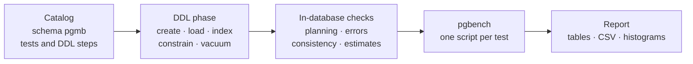

<div align="center">

# pg_microbenchmark

**A PostgreSQL benchmark written entirely in SQL.**

It generates its own data, times every DDL step, runs a tagged catalog of
more than 2,000 queries, and keeps the results in tables you can compare
between runs.


</div>

---

## Contents

- [Why](#why)
- [Quick start](#quick-start)
- [How a run works](#how-a-run-works)
- [What you get](#what-you-get)
- [Configuration](#configuration) — [variables](#variables) · [presets](#presets) · [scope and write ratio](#scope-and-write-ratio) · [tags](#tags)
- [Recipes](#recipes)
- [Test catalog](#test-catalog)
- [Data](#data)
- [Optional features](#optional-features) — [row level security](#row-level-security) · [intarray](#intarray)
- [Comparing two server configurations](#comparing-two-server-configurations)
- [Reports](#reports)
- [Result tables](#result-tables)
- [Adding a test](#adding-a-test)
- [Cleaning up](#cleaning-up)
- [Notes and limits](#notes-and-limits)

## Why

Built for:

- testing a modified PostgreSQL build or a patch for performance regressions,
- finding hardware limits,
- comparing server settings and machines.

The benchmark itself needs only `psql` and `pgbench`, both part of PostgreSQL.
Data is generated inside the server, so there is nothing to download and
nothing to install.

| | |
|---|---|
| **Deterministic data** | values come from hash functions of the row number, never from `random()`: the same scale gives the same data on every machine |
| **Continuous scaling** | amount of data, number of connections and write share are plain numbers |
| **Five presets** | from a three-minute sanity check on empty tables to OLTP and OLAP workloads |
| **Tagged tests** | run one topic, one tag, or one test by regular expression |
| **More than timings** | plan stability, expected errors, result consistency, row estimates, memory and temporary files |
| **Comparable runs** | results accumulate in tables; one script puts two runs side by side |

## Quick start

Run from the repository root:

```bash
createdb bench
psql -X -d bench -f bench.sql -v preset=sanity            # does everything run? (~3 min, no data)
psql -X -d bench -f bench.sql -v preset=micro-benchmark   # first numbers on tiny data
```

> [!WARNING]
> Give the benchmark a database of its own. It creates the schemas `pgmb`,
> `pgmb_data` and `pgmb_results`, drops and reloads `pgmb_data` on every run
> and generates a heavy load. On its first use in a database that already
> contains other tables `bench.sql` stops and asks for `-v shared_db=1`.

## How a run works



1. The `pgmb` schema (framework and test catalog) is rebuilt.
2. **DDL phase** — `pgmb_data` is dropped and recreated; tables are created,
   loaded, indexed, constrained and vacuumed, and every step is timed.
3. **DML phase** — the in-database checks run first, then `pgbench` is driven
   with one generated script per test.
4. A report is printed and CSV files are written to `out/`.

Results accumulate in the `pgmb_results` schema, which is never dropped.

## What you get

One line per test, with a latency histogram of 24 logarithmic buckets from
0.01 ms to 10 s:

```text
         test          |  tps   |  p50  |  p95   |   p99   |         histogram
 index.pk_point        |  446.3 | 0.150 |  0.569 |   2.183 | | ▁▅▇██▅▂▁▁▁▁  ▁ ▁▁      |
 locking.for_update    |  133.4 | 1.202 | 57.963 | 172.011 | |     ▁▂▆█▄▂▁▁▁▁▁▂▁      |
```

Next to it: the time, WAL volume and size of every load and index build,
planning time and plan stability, row estimates against reality, memory and
temporary files, and the outcome of every check.

## Configuration

### Variables

All are passed with `-v name=value`.

**Workload**

| Variable | Default | Meaning |
|---|---|---|
| `preset` | `mini-benchmark` | base configuration, see [Presets](#presets) |
| `data_scale` | preset | multiplier for the amount of data (continuous); `0` leaves the tables empty |
| `conn_scale` | `1` | multiplier for the preset's number of connections (continuous) |
| `write_ratio` | preset | share of write transactions, 0..1 |
| `scope` | `rw` | `rw`, `readonly`, `writeonly`, `createonly` (DDL phase only) |
| `mode` | preset | `isolated` (one pgbench run per test) or `mixed` (one weighted workload) |
| `duration` | preset | seconds per pgbench run; `0` runs every script once |
| `warmup` | preset | seconds of unmeasured warm-up before each pgbench run |
| `protocol` | `simple` | pgbench query mode: `simple`, `extended`, `prepared` |

**Selecting tests**

| Variable | Default | Meaning |
|---|---|---|
| `tags` | preset | comma-separated tag filter; `all` clears the preset's filter |
| `topics` | all | comma-separated topic filter, e.g. `cte,window` |
| `only` | *(empty)* | regular expression on the test id, on top of the other filters |
| `label` | *(empty)* | free text stored with the run, e.g. a patch name |

**Data**

| Variable | Default | Meaning |
|---|---|---|
| `skip_ddl` | `0` | `1` reuses data loaded by a previous run with the same `data_scale`, `arr_len` and `arr_distinct` |
| `arr_len` | `20` | number of elements in `g_intarr.arr_n` |
| `arr_distinct` | `1000` | number of distinct values drawn for `g_intarr.arr_n` |

**Server and optional features**

| Variable | Default | Meaning |
|---|---|---|
| `gucs` | *(empty)* | extra server settings for the run, `name=value,name=value` (no spaces inside a value). Set in the benchmark session, passed to every pgbench connection, recorded in `pgmb_results.run.settings` |
| `stmt_timeout` | `120s` | `statement_timeout` for the DML phase; `0` disables it |
| `plan_iterations` | `20` | EXPLAIN repetitions per test in the planning check |
| `rls_role` | *(empty)* | role for the row level security tests; empty means they are not registered ([details](#row-level-security)) |
| `intarray` | `0` | `1` installs the `intarray` extension and registers the tests that use it ([details](#intarray)) |
| `shared_db` | `0` | `1` allows the first run in a database that already holds other tables |

**Environment**

| Variable | Default | Meaning |
|---|---|---|
| `pgbench` | `pgbench` | pgbench binary, e.g. the one from your own build |
| `outdir` | `out` | directory for generated scripts, pgbench logs and CSV files (must exist) |
| `cat` | `cat` | command that concatenates the pgbench log files; use `type` on Windows |

### Presets

| Preset | data_scale | clients | write_ratio | mode | per run | tags |
|---|---:|---:|---:|---|---:|---|
| `sanity` | 0 | 1 | 0.5 | isolated | 1 transaction | all |
| `micro-benchmark` | 0.01 | 1 | 0.5 | isolated | 1 s | all |
| `mini-benchmark` | 1 | 4 | 0.5 | isolated | 3 s | all |
| `mini-oltp` | 1 | 16 | 0.3 | mixed | 60 s | `oltp,perf` |
| `mini-olap` | 5 | 2 | 0 | isolated | 10 s | `olap` |

`data_scale=1` is roughly 0.8 GB including indexes. Presets live in
`presets/presets.sql`.

> [!TIP]
> `sanity` is the fastest way to find out whether everything still parses,
> plans and runs, for example on a patched server: about three minutes for
> the whole catalog. The tables stay empty (`data_scale=0`) and pgbench
> executes every script once (`duration=0`), so its timings mean nothing; the
> results go through the same tables and reports as any other run. Parameters
> are still drawn from each table's minimum row count, and the tests that
> need rows to mean anything (tag `needs_data`, about 60 of them) are left out.

### Scope and write ratio

In `mixed` mode the script weights are set so that `write_ratio` of all
transactions are writes. In `isolated` mode the ratio only selects tests: `0`
runs reads only, `1` writes only, anything else both. `readonly` and
`writeonly` force the ratio to 0 and 1.

Tests that take row locks (`SELECT ... FOR UPDATE` and friends) count as writes.

### Tags

Every test carries tags. Six of them name a measurement:

| Tag | Measured by | What |
|---|---|---|
| `perf` | pgbench | tps, failures, latency average, p50, p95, p99, max, a latency histogram, temporary files and WAL |
| `planning` | in-database | planning time and memory, and whether the plan shape stays the same across parameter values |
| `errors` | in-database | the statement must fail with the expected SQLSTATE |
| `consistency` | in-database | equivalent formulations must return identical rows |
| `checksum` | in-database | an order-independent checksum of the whole result, to compare the same test between two runs |
| `analyze` | in-database | one `EXPLAIN ANALYZE` per test: the worst ratio between estimated and actual rows over the plan nodes (q-error), and what the nodes kept in memory or wrote to disk |

The others describe the test: `oltp`, `olap`, `locking`, `concurrency`, and
`needs_data` for tests that are skipped when the tables are empty.

`-v tags=...` narrows the run. Descriptive tags select tests; measurement tags
select both tests and which measurements run:

| Command | Effect |
|---|---|
| `-v tags=olap` | everything, for OLAP tests |
| `-v tags=planning` | only the planning check |
| `-v tags=oltp,perf` | only pgbench, on OLTP tests |

> [!NOTE]
> A tag named `optin_<something>` keeps a test out of every run that does not
> name that tag. It is used for tests that need a lot of disk space.

## Recipes

```bash
# patch vs. baseline, same data scale
psql -X -d bench -f bench.sql -v preset=mini-benchmark -v label=baseline
psql -X -d bench -f bench.sql -v preset=mini-benchmark -v label=my-patch
psql -X -d bench -f report/compare.sql

# connection scaling without reloading data
psql -X -d bench -f bench.sql -v preset=mini-oltp -v conn_scale=1
psql -X -d bench -f bench.sql -v preset=mini-oltp -v conn_scale=4 -v skip_ddl=1

# load and index build speed only
psql -X -d bench -f bench.sql -v data_scale=10 -v scope=createonly

# planner only, two topics
psql -X -d bench -f bench.sql -v skip_ddl=1 -v tags=planning -v topics=plan,cte

# a handful of tests, by name
psql -X -d bench -f bench.sql -v skip_ddl=1 -v only='^cte\.graph_diamond'

# the same tests under two server settings
psql -X -d bench -f bench.sql -v topics=sort -v label=small -v gucs='work_mem=4MB'
psql -X -d bench -f bench.sql -v topics=sort -v label=large -v gucs='work_mem=256MB' -v skip_ddl=1
```

## Test catalog

A topic is the part of a test id before the first dot. Counts are with every
optional feature enabled.

| Topic | Tests | Covers |
|---|---:|---|
| [`cte`](#the-cte-topic-file-by-file) | 1,360 | common table expressions from every side; see the breakdown below |
| `array` | 303 | 0 to 2000 elements, `@>` `&&` `<@` `= ANY`, GIN vs sequential plans, unnest, construction, updates; large `array_agg` results passed to functions; the `integer[]` columns of `g_intarr`; intarray operators and `query_int` |
| `index` | 143 | build times; btree (unique, multi-column, INCLUDE, partial, expression, pattern), skip scan, backward scans, min/max, row comparisons, `IN` lists, hash, BRIN, GIN, bitmap AND/OR, HOT vs non-HOT updates; GIN and GiST operator classes of intarray |
| `plan` | 80 | join chains of 2 to 16 relations, `IN` lists up to 10,000 items, large `VALUES` lists, long OR/CASE lists, planner transformations, row count misestimates, predicate pushdown, parameter-dependent plans |
| `pcte` | 77 | materialized top-level CTEs as independent units of work, for [comparing two server configurations](#comparing-two-server-configurations) |
| `sort` | 69 | `ORDER BY` of the main query (top-N, key types, collation, input shape, spilling), Incremental Sort, ordering inside aggregates |
| `distinct` | 64 | `SELECT DISTINCT`, `DISTINCT ON`, `GROUP BY`, set operations, loose index scan, `DISTINCT` inside aggregates |
| `nulls` | 44 | `COALESCE`, `NULLIF`, `IS [NOT] DISTINCT FROM`, NULL-safe joins, three-valued logic, `NOT IN` with NULLs, NULLs in aggregates, arrays, strings and strict functions |
| `seqscan` | 31 | whole-table reads of narrow and wide rows, filter selectivity and column position, early termination, serial vs parallel, TOAST, TID ranges, `TABLESAMPLE` |
| `funcall` | 20 | functions that do nothing: SQL inlined or not, PL/pgSQL plain, strict, security definer, SET clause, nested, exception block, SRF, procedure |
| `window` | 19 | ranking, running and moving aggregates, ROWS/RANGE/GROUPS frames, several windows, run conditions |
| `materialized` | 15 | default vs `MATERIALIZED` vs `NOT MATERIALIZED` for filter push-down, two readers, join push-down, LIMIT |
| `locking` | 14 | `FOR UPDATE`, `FOR NO KEY UPDATE`, `FOR SHARE`, `FOR KEY SHARE`, implicit locks from UPDATE and foreign keys, `SKIP LOCKED` |
| `lateral` | 13 | top-N per group, dependent chains, set-returning functions, unnest, unpivot |
| `resultsize` | 12 | 0 to 100k rows, narrow and wide rows, one large value |

### The `cte` topic, file by file

<details>
<summary><b>Basics</b> — shapes, joins, access paths, predicates</summary>

| File | Covers |
|---|---|
| `cte.sql` | chains, diamonds, unused and empty CTEs, shadowing, recursion (tree, graph, `CYCLE`, `SEARCH`), data-modifying CTEs |
| `cte_join.sql` | join types, conditions and shapes between CTEs and between CTEs and tables |
| `cte_scan.sql` | access paths inside a CTE and kinds of readers over it |
| `cte_where.sql` | predicates inside and outside a CTE, and what blocks push-down |
| `cte_shape.sql` | pruning of unneeded CTEs, columns, joins and branches; nesting to five levels and in every clause |
| `cte_joinalgo.sql` | CTEs under Nested Loop, Hash Join and Merge Join, natural and forced |
| `cte_graph.sql` | dependency graphs: single, linear, deep chain, fan-out, fan-in, diamonds, trees, wide, deep, dense, sparse and disconnected DAGs, orphans, dead branches, shared nodes, repeated leaves, nested and shadowed scopes, recursive nodes — each as default, all `MATERIALIZED` and all `NOT MATERIALIZED` |
| `cte_scope.sql` | a CTE named like a table, forward references with `RECURSIVE`, column lists, ambiguity, `VALUES`/`TABLE`, correlation with the outer query, `UNION` branches, `SEARCH`/`CYCLE` column names |
| `cte_alternatives.sql` | the same six tasks written as a CTE, a subquery, `LATERAL`, a view, a materialized view and a temporary table |
| `cte_edge.sql` | edge cases, each inlined and materialized: zero rows, one row, millions of rows; NULLs, duplicates, arrays, JSONB and wide text as content; 100 references; nested loops that rescan the CTE; unread CTEs; `LIMIT`, `EXISTS` and conditionally executed subplans; the final `ORDER BY` checked without relying on the CTE's own order |

</details>

<details>
<summary><b>Planner</b> — materialization, estimates, plan cache, join search</summary>

| File | Covers |
|---|---|
| `cte_materialize.sql` | inlining versus materialization rules (stable, volatile, `nextval`, raising functions, number of readers), laziness under `LIMIT`/`OFFSET`/`EXISTS`/`CASE`, partition pruning through a CTE, join reordering, wide rows, spilling, parallel plans |
| `cte_estimate.sql` | row estimates across the CTE boundary: filters, kinds of CTE output, joins that follow the estimate, sort order carried out of a CTE |
| `cte_plancache.sql` | prepared statements, `plan_cache_mode`, skewed parameters, partition pruning, PL/pgSQL and SQL functions, invalidation |
| `cte_collapse.sql` | size of the join problem after inlining: `from_collapse_limit`, `join_collapse_limit`, exhaustive search against GEQO |
| `cte_mix.sql` | mixes where several of these areas affect each other |

</details>

<details>
<summary><b>Executor</b> — partial reads, memory, parallelism, recursion</summary>

| File | Covers |
|---|---|
| `cte_partial.sql` | CTEs that are not read to the end (`LIMIT`, `FETCH FIRST`, `EXISTS`, `IN`/`ANY`/`ALL`, semi and anti joins, empty join sides, `WHERE false`, untaken `CASE` branches, `UNION ALL`, cursors, several readers), checked with rows that would fail if they were read |
| `cte_memory.sql` | memory and temporary files of materialized CTEs under small and large `work_mem`: one CTE, many at once, row width, unused columns, TOAST, rescans, sorts and hashes inside |
| `cte_parallel.sql` | partial aggregation, Parallel Hash Join, Gather Merge, Parallel Append over branches and partitions, parallel index paths, leader participation, number of workers, several Gathers, what a CTE Scan does to the plan above it |
| `cte_recursive.sql` | `UNION` versus `UNION ALL`, deduplication, shapes, NULLs, types, domains, collations, `SEARCH`, `CYCLE`, path arrays, what the parser rejects |

</details>

<details>
<summary><b>Writes and transactions</b> — DML, locks, isolation, security</summary>

| File | Covers |
|---|---|
| `cte_dml.sql` | `MERGE ... RETURNING` with `merge_action()`, `RETURNING old/new`, writers without `RETURNING`, unreferenced or behind `LIMIT 0`, several readers, several writers on one row, constraints, triggers, chains of writers, recursive sources, `ON CONFLICT`, row movement between partitions |
| `cte_lock.sql` | `FOR UPDATE`/`SHARE` inside a CTE against the main query and against a derived table, `SKIP LOCKED`, `NOWAIT`, several readers, outer `LIMIT` |
| `cte_txn.sql` | deferrable constraints, parallel safety of functions, isolation levels, snapshots of `STABLE` and `VOLATILE` functions, security barrier views, `statement_timeout` |
| `cte_notify.sql` | notifications sent from CTEs with `pg_notify()` |
| `cte_rls.sql` | CTEs over a table with row level security — only with `rls_role` |

</details>

<details>
<summary><b>Arrays</b> — integer[] and intarray</summary>

| File | Covers |
|---|---|
| `cte_array.sql` | CTEs returning `integer[]`: literals, empty and NULL arrays, dimensions and lower bounds, element types, `array_agg` as a source, unnest and re-aggregation, TOAST, whole-array `UNION`/`DISTINCT`/`GROUP BY` |
| `cte_intarray.sql` | `sort()`/`uniq()` of intarray inside CTEs: materialized or inlined, many readers, predicate pushdown, unused arrays, `LIMIT`, `work_mem`, join order — only with `intarray=1` |
| `cte_intarray_dml.sql` | writes to `integer[]` columns with intarray operators, HOT against indexed-array updates, NULL arrays and NULL elements, when the extension's errors are raised — only with `intarray=1` |

</details>

## Data

Tables are generic and named after their shape; see `data/tables.sql`.

| Table | Shape |
|---|---|
| `g_narrow` | many rows, few columns, one column per value distribution |
| `g_wide` | wide rows with integer columns of growing cardinality |
| `g_dim` | small dimension |
| `g_parent` / `g_child` | 1:N relation, skewed |
| `g_tree`, `g_graph` | complete 4-ary tree; cyclic directed graph |
| `g_array`, `g_array_big` | small, medium and 2000-element arrays |
| `g_intarr` | a dozen `integer[]` columns of fixed and parameterized length and cardinality |
| `g_events` | time series; with it the materialized view `mv_entity_totals` and a few views |
| `g_part` | range-partitioned, 16 partitions |
| `g_dml`, `g_dml_trig`, `g_dml_audit`, `g_dml_defer`, `g_ia_dml` | scratch tables for writers: constraints, triggers, deferrable constraints, array columns |
| `g_rls` | row level security policies |

Values come from hash functions of the row number, never from `random()`, so
the same `data_scale` produces the same data on every machine and run.
Generation time is part of the reported load time.

> [!TIP]
> Every table and column carries a `COMMENT` describing what the load puts
> there (`data/comments.sql`). In psql: `\d+ pgmb_data.g_narrow`.

## Optional features

The benchmark needs no superuser and no special role attribute. Two groups of
tests need something extra and are registered only on request.

### Row level security

Row level security does not apply to superusers or to the owner of a table,
so the `cte.rls_*` tests must run as some other role:

```bash
psql -X -d bench -f rls_role.sql                       # once; needs CREATEROLE
psql -X -d bench -f bench.sql -v rls_role=pgmb_rls ...
psql -X -d bench -f rls_role.sql -v drop=1             # remove the role again
```

`rls_role.sql` creates a `NOLOGIN` role without any attribute
(`-v rls_role=name` picks another name) and lets the benchmark user `SET ROLE`
to it (`-v bench_user=name` when that is not the user running the script).
Any existing role works as long as it is not a superuser, has no `BYPASSRLS`
and the benchmark user may `SET ROLE` to it; `bench.sql` checks this before
loading data.

During the run the role is granted `SELECT`/`UPDATE` on `g_rls` and `SELECT`
on `g_dim`, nothing else. Each test switches to it for one transaction with
`SET LOCAL ROLE`. A role is global to the cluster, so `clean.sql` leaves it
alone.

### intarray

`-v intarray=1` adds the tests built on the `intarray` extension
(`cte.intarray_*`, `array.intarray_*`, `array.queryint_*`,
`index.intarray_*`) and indexes with its operator classes on `g_intarr`. The
extension is trusted, so `CREATE` on the database is enough; the server needs
the contrib package.

> [!IMPORTANT]
> The extension is installed into its own schema, `pgmb_intarray`, which is
> deliberately **not** on the `search_path`. Once intarray's operators are
> visible, `integer[] @> integer[]` resolves to them instead of the built-in
> operators, the default GIN indexes stop matching, and every other array
> test would silently measure something else.

Tests therefore name the schema — `pgmb_intarray.sort(a)`,
`a OPERATOR(pgmb_intarray.@>) b` — and the tests about name resolution put the
schema on the path for one transaction.

**Index variants.** Comparing operator classes needs several indexes of the
extension on one column, and the planner would then pick one by cost. Each
variant is therefore a partial index `WHERE id <> -K`: no id is negative, so
it holds every row, and a test selects variant K by adding `AND id <> -K`
(the list is in `data/indexes.sql`). Their build times and sizes are in the
DDL part of the report. They are not small: about 1.3 MB per 1000 rows of
`g_intarr`, most of it the GiST index with `siglen = 2024` and the GIN index
on 100-element arrays.

If the database already has intarray in another schema, that schema is used
instead. Should it be on the benchmark's `search_path` (for example `public`),
the plain array tests are affected as described above. `clean.sql` drops
`pgmb_intarray`; an extension that was there before is left alone.

## Comparing two server configurations

`gucs` runs the same tests under different settings, `report/compare.sql`
puts two runs side by side, and `report/explain.sql` shows the plans.

```bash
psql -X -d bench -f bench.sql -v preset=mini-olap -v topics=pcte -v label=off \
     -v gucs='enable_parallel_cte=off'
psql -X -d bench -f bench.sql -v preset=mini-olap -v topics=pcte -v label=on \
     -v gucs='enable_parallel_cte=on,max_parallel_cte_workers=3' -v skip_ddl=1
psql -X -d bench -f report/compare.sql -v a=<run off> -v b=<run on>
psql -X -d bench -f report/explain.sql -v test='^pcte\.shape' -v analyze=1 \
     -v gucs='enable_parallel_cte=on'
```

The `pcte` topic was written for this kind of comparison (a patch that
computes materialized CTEs in parallel workers), but its tests are plain SQL
and give the serial baseline on any server.

| Question | How |
|---|---|
| number of workers | repeat with `max_parallel_cte_workers=1,2,3,5,7` in `gucs` |
| without parallel query | add `max_parallel_workers_per_gather=0` to `gucs` |
| input size and threshold | `pcte.threshold_rows_*`; `data_scale` 1, 10, 60 gives tables of 1M, 10M, 60M rows |
| result size | `pcte.transfer_*` (rows × bytes); add `temp_file_limit=...` to `gucs` to bound disk use |
| many sessions | `-v tags=pcte_mix,perf -v mode=mixed -v conn_scale=N` with the `micro-benchmark` preset (1 client × N) |
| short queries under load | `-v tags=pcte_oltp,perf -v conn_scale=N` |
| same results in both runs | every single-statement read test stores a checksum of its whole result; `compare.sql` counts `same_result` / `DIFFERENT RESULT` and names every test that differs |

> [!CAUTION]
> `-v tags=optin_bigtransfer` runs three `pcte.transfer_*` tests that write
> 1 GB or more of temporary files per CTE (up to about 10 GB each at
> `data_scale` 10 and above). They are in no other run. Give them a limit, for
> example `-v gucs='temp_file_limit=12GB'` (the limit is per process).

## Reports

| Script | Shows |
|---|---|
| `report/summary.sql` | one run in full; `-v run_id=N`, default: the last run. Printed at the end of every run |
| `report/compare.sql` | two runs side by side: settings that differ, DDL steps, performance, planning, estimates, temporary files, result checksums; `-v a=N -v b=M`, default: the last two |
| `report/histogram.sql` | latency histograms with counts and cumulative percentages; `-v run_id=N -v test=<regex>` |
| `report/explain.sql` | `EXPLAIN` of every matching test with its parameters bound; `-v test=<regex> -v analyze=1 -v gucs=...` |

`explain.sql` runs every test inside a transaction that is rolled back. For
tests made of several statements it executes the preparing ones (`SET LOCAL`,
`CREATE TEMP TABLE`) and explains each query; a cursor is explained as its
query with `LIMIT` set to the size of its first `FETCH`.

## Result tables

| Table | Content |
|---|---|
| `pgmb_results.run` | one row per run: configuration, server version, non-default settings |
| `pgmb_results.ddl_step` | elapsed time, WAL volume, relation size and row count per DDL step |
| `pgmb_results.perf` | pgbench result per test |
| `pgmb_results.latency` | latency percentiles (p50, p95, p99) and maximum per test |
| `pgmb_results.latency_hist` | latency histogram per test, logarithmic buckets, four per decade |
| `pgmb_results.planning` | planning time (min, median, max), planner memory, number of distinct plan shapes |
| `pgmb_results.checks` | outcome of error and consistency checks, result checksums |
| `pgmb_results.explain_stats` | per test tagged `analyze`: q-error, the node it comes from, rows estimated and returned, memory and disk use of the plan nodes |
| `pgmb_results.resource` | temporary files, temporary bytes and WAL written during each test's pgbench run (isolated mode) |
| `pgmb_results.pgbench_raw` | pgbench command lines and their full output |

`pgmb_results.run_overview` lists all runs. Every run also writes these tables
as CSV files to `out/`.

## Adding a test

A test is one call in a topic file:

```sql
call pgmb.reg('cte.my_test', '{perf,planning,oltp}', $q$
with p as (select * from g_parent where id = :id)
select * from p$q$,
    setup => '\set id random(1, :n_g_parent)');
```

| Argument | Meaning |
|---|---|
| id | `<topic>.<name>` |
| tags | measurement and descriptive tags |
| `setup` | pgbench `\set` lines; the same lines are evaluated in the server for the in-database checks. `:n_<table>` is the table's row count at the current scale |
| `kind => 'write'` | marks a write |
| `equiv => 'group'` | puts the test in a consistency group |
| `expect_error => '42P01'` | makes it an error test |
| `protocol => 'prepared'` | fixes the pgbench query protocol for this test (`isolated` mode; in `mixed` mode one pgbench runs every script and the run's `protocol` is used) |

A test may be a transaction with `SET LOCAL` (or `CREATE TEMP TABLE`,
`ANALYZE`) in front of a single query; the in-database checks cover that form
too. Any other multi-statement script is measured by pgbench only.

DDL steps are registered with `pgmb.reg_ddl(id, kind, sql, target)`, kind
being `schema`, `load`, `index`, `constraint` or `maintenance`. A new topic is
a new file plus one `\ir` line in `bench.sql`.

## Cleaning up

```bash
psql -X -d bench -f clean.sql                 # drop test data and framework, keep results
psql -X -d bench -f clean.sql -v results=1    # drop the stored results too
psql -X -d bench -f clean.sql -v run_id=N     # delete one run from the results
```

Files in `out/` (generated scripts, pgbench logs, CSV) stay: psql cannot
delete files. They are ignored by git; remove them by hand. The pgbench logs
hold one line per transaction, so long runs with many connections produce
large files.

## Notes and limits

- pgbench is started from psql and connects with the database, host, port and
  user of the psql session; passwords must come from `PGPASSWORD` or `.pgpass`.
- WAL volume and temporary file counters are read from the server, so other
  activity on the same cluster inflates them. Benchmark on an otherwise idle
  server.
- Temporary files and WAL per test are recorded in `isolated` mode only.
- The in-database checks evaluate pgbench's `random_zipfian()` with an
  approximation; pgbench itself uses the real one.
